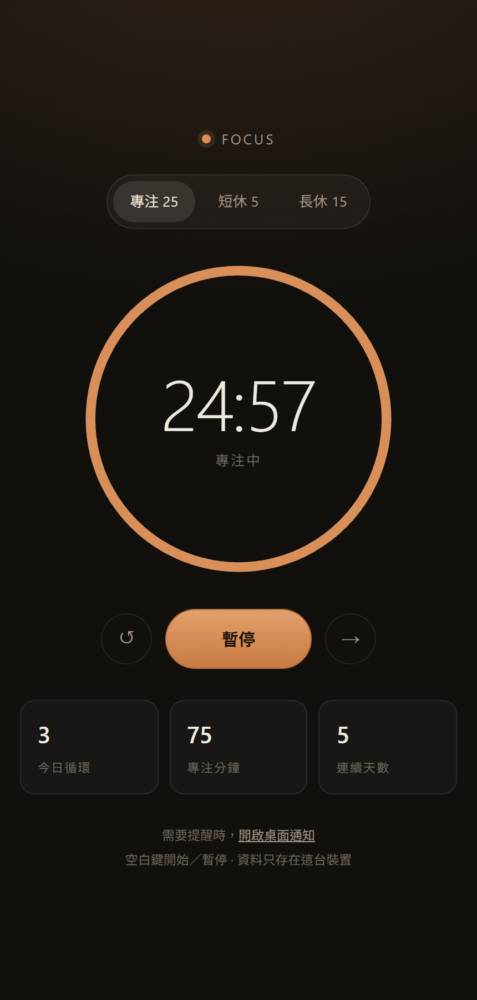

# 專注鐘 · 極簡番茄計時

> 25 分鐘，只做一件事。沒有帳號、沒有雲端、沒有社群 —— 打開就開始。

<p>
  
  
  
  
</p>

<p>
  <a href="https://dahyun001.github.io/pomodoro/"><b>▶ 線上直接用</b></a>
  &nbsp;·&nbsp;
  <a href="#本機執行">本機執行</a>
</p>



---

## 為什麼又一個番茄鐘

因為大部分番茄鐘想變成待辦清單、專案管理、團隊協作工具。這個不想。

它只有一個畫面：**一顆環，一個數字，兩顆按鈕**。沒有任務清單要你維護，沒有帳號要你註冊，沒有 streak 通知要你回來。你按下開始，它安靜倒數；時間到，響一聲。

## 功能

| 功能 | 說明 |
|---|---|
| **25 / 5 / 15** | 專注 25 分、短休 5 分、長休 15 分，可手動切換 |
| **自動接續** | 每完成 **4 個專注循環**自動進長休，其餘進短休 |
| **環形進度** | SVG `stroke-dasharray` 逐秒推進，分頁標題同步顯示剩餘時間 |
| **今日統計** | 完成循環數、累積專注分鐘、連續使用天數；跨日自動重置，昨天有紀錄才續 streak |
| **提示音** | WebAudio 即時合成雙音，不需要音檔 |
| **桌面通知** | 可選授權；倒數結束時提醒（切到別的視窗也不會漏掉） |
| **鍵盤操作** | `空白鍵` 開始／暫停、`R` 重設、`→` 跳過 |
| **時間校正** | 從背景切回前景時依實際時間戳重算，不會因為瀏覽器節流而變慢 |
| **可安裝 / 離線** | service worker 快取外殼，HTTPS 下可加到主畫面 |

單檔 HTML 12 KB（gzip 後約 5 KB），零依賴、零外部請求。

## 設計取捨

| 決定 | 原因 |
|---|---|
| 用時間戳而非 `setInterval` 累加 | 分頁進背景會被瀏覽器節流到 1 次/秒甚至更低，累加會失準 |
| 統計只寫 `localStorage` | 這是個人計時器，不需要帳號；也避免「為了看統計而聯網」 |
| 不強制全螢幕、不鎖其他 App | 番茄鐘的價值是提醒，不是監控 |
| 長休用 `done % 4` 判定 | 傳統番茄工作法節奏；不需額外狀態機 |

## 本機執行

```bash
git clone https://github.com/Dahyun001/pomodoro.git
cd pomodoro
open index.html        # macOS
start index.html       # Windows
```

測 PWA（service worker 需要 http/https）：

```bash
python -m http.server 8000
# → http://127.0.0.1:8000/
```

## 部署

任何靜態託管：GitHub Pages、Cloudflare Pages、Netlify、Vercel、nginx。

GitHub Pages：`Settings → Pages → Deploy from a branch → main / (root)`。

## 隱私

- 沒有任何網路請求（除了載入自己）
- 沒有 analytics、cookie、外部字型
- 統計只存在你的 `localStorage`，清除瀏覽器資料就消失

## 已知限制

- 統計以「本機日期」為界，跨時區旅行時可能出現一天誤差
- 桌面通知需瀏覽器授權；iOS Safari 需先「加到主畫面」才支援
- 提示音受瀏覽器自動播放政策限制，**第一次必須由點擊觸發**（本工具本來就是點擊開始，實務上不影響）

## 授權

[MIT](LICENSE) © 2026 Dahyun001

---

同系列：[亂碼救星 · TXT 編碼轉換](https://github.com/Dahyun001/txt-fix) · [Soul Reader 本地閱讀器](https://github.com/Dahyun001/soul-reader)
